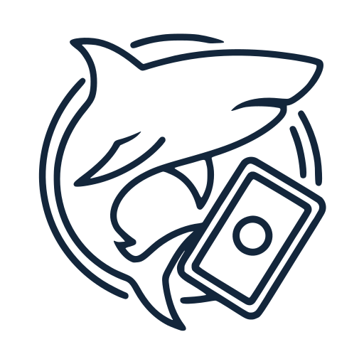

<p align="center">
  
</p>

<h1 align="center">Sharkyard</h1>

<p align="center">
  Coleção e decks de Magic: The Gathering para você e seus amigos, rodando no seu próprio computador.
</p>

---

O Sharkyard é um app em Python que organiza coleção, decks e partidas de Magic. Ele roda como janela no desktop
ou como site, e um grupo de amigos pode usar o mesmo servidor pelo navegador (inclusive instalando como app no
celular). Os dados das cartas vêm do [Scryfall](https://scryfall.com), com uma cópia local atualizada todo dia.

## O que ele faz

- **Busca de cartas:** busca rápida com sugestões, busca avançada (gera a sintaxe do Scryfall), página da carta
  com todas as edições, preços, legalidade e rulings. Funciona também pelo nome em português.
- **Coleção:** lotes por edição, foil, proxy, preço pago e observações; pastas; seleção múltipla; versões
  personalizadas (alters, proxies com arte própria) com imagem.
- **Decks:** montagem com busca, lista em texto, cartas da coleção ou cartas personalizadas; zona de comando com
  parceiros e companheiro; várias versões por deck com comparação; validação do formato; estatísticas (curva,
  fontes de mana, chance de mão inicial); exportação para Arena, Moxfield, MTGO, Cockatrice e CSV.
- **Visualização:** cada deck abre em quatro modos (lista, texto, imagens, pilhas), com a carta grande ao lado do
  mouse.
- **Amigos:** contas com convite, decks visíveis para o grupo, ranking de vitórias por temporada e ferramentas
  de administração (senha temporária, desativar e apagar contas).
- **Aparência:** seis temas, modo claro, escuro ou automático, layout próprio para celular e instalação como app
  (PWA).

Os detalhes de cada parte estão em [docs/FUNCIONALIDADES.md](docs/FUNCIONALIDADES.md).

## Tecnologias

Python 3.12 ou mais novo, [NiceGUI](https://nicegui.io) (interface web e desktop com o mesmo código), SQLite com
SQLAlchemy 2 e migrações Alembic, httpx para a API do Scryfall, argon2 para as senhas e pywebview para a janela
desktop.

## Instalação

```bash
git clone https://github.com/Seacelol/sharkyard.git
cd sharkyard
python -m venv .venv
# Windows: .venv\Scripts\activate    Linux/macOS: source .venv/bin/activate
pip install -r requirements.txt
```

## Como rodar

```bash
python main.py                              # janela desktop
python main.py --web                        # site em http://localhost:8080
python main.py --web --host 127.0.0.1       # site só para este computador (use assim atrás de um túnel)
python main.py --web --port 9000            # outra porta
```

No Windows, o `sharkyard.bat` sobe o modo web com prioridade baixa (para não pesar enquanto você usa o PC) e usa
o ambiente virtual `.venv` se ele existir.

Na primeira vez, crie a sua conta: o primeiro cadastro vira administrador. Os próximos precisam do código de
convite, que aparece em **Minha conta**.

O banco é criado e atualizado sozinho ao iniciar. Na primeira execução o app também baixa a cópia local das
cartas do Scryfall em segundo plano (alguns minutos); até lá, tudo funciona direto pela API.

## Acesso dos amigos pela internet

O app não precisa de porta aberta no roteador. Rode com `--web --host 127.0.0.1` e exponha por um túnel:

| Opção | Endereço | Observação |
|---|---|---|
| Cloudflare, túnel rápido | `https://<aleatório>.trycloudflare.com` | Sem conta. O endereço muda a cada reinício. O `tunel.bat` sobe em segundo plano e copia o link. |
| Cloudflare, túnel com nome | `https://sharkyard.seu-dominio.com` | Precisa de um domínio na Cloudflare. Roda como serviço do Windows e o endereço não muda. |
| Tailscale Funnel | `https://<pc>.<rede>.ts.net` | Grátis, endereço fixo, `tailscale funnel --bg 8080`. |

O computador precisa ficar ligado e sem suspender. Com HTTPS (qualquer uma das opções acima), os amigos podem
instalar o site como app no celular ou no PC.

## Configuração

| Variável / opção | Padrão | Para quê |
|---|---|---|
| `--web` | desligado | Abre como site em vez de janela desktop. |
| `--host` | todas as interfaces | Use `127.0.0.1` quando o acesso de fora for por túnel. |
| `--port` | `8080` | Porta do servidor. |
| `MTG_DATA_DIR` | `~/.mtg-collection` | Pasta dos dados (banco, imagens, sessões, cache). |
| `MTG_CATALOG` | `1` | `0` desliga a cópia local do Scryfall e usa só a API. |

Limites de tamanho dos nomes e outras constantes ficam em `mtg_collection/config.py`.

## Dados e backup

Tudo que é do usuário fica fora da pasta do projeto, em `MTG_DATA_DIR`:

| Arquivo | O que é | Backup? |
|---|---|---|
| `data.db` | Banco SQLite: contas, coleções, decks, vitórias | Sim |
| `custom-images/` | Imagens enviadas (versões personalizadas, capas, ícones) | Sim |
| `secret.key` | Assina o cookie de sessão. Se apagar, todos entram de novo | Opcional |
| `sessions/` | Sessões abertas nos navegadores | Não |
| `cache/` | Cópia local do Scryfall e símbolos de edição. É refeito sozinho | Não |

Atualizar o código (por exemplo, `git pull`) não mexe nesses arquivos. Depois de atualizar, rode
`pip install -r requirements.txt` e reinicie o app; as migrações rodam sozinhas.

## Segurança

- Senhas guardadas só como hash argon2; trocar a senha derruba as outras sessões.
- Limite de tentativas de login por usuário e por endereço, à prova de tentativas em paralelo.
- Toda permissão é conferida no servidor: cada dado tem dono, e decks de amigos só aparecem quando marcados como
  visíveis.
- Imagens enviadas só são servidas a quem pode vê-las; nomes de arquivo validados.
- Sem e-mail: quem esquece a senha recebe do administrador uma senha temporária, que precisa ser trocada no
  primeiro acesso.

## Desenvolvimento

```bash
pip install -r requirements-dev.txt
pytest                 # cerca de 390 testes, sem acessar a internet
ruff check .           # lint
```

- Arquitetura, estrutura dos arquivos e as decisões principais: [docs/ARQUITETURA.md](docs/ARQUITETURA.md).
- Mudou uma tabela em `mtg_collection/database/tables.py`? Gere a migração com
  `alembic revision --autogenerate -m "descrição"` e confira o arquivo gerado.
- Lógica que não é de tela vai em `mtg_collection/services/`, com teste em `tests/`. Os testes de interface usam o
  usuário simulado do NiceGUI e um Scryfall falso.

## Créditos e aviso legal

Os dados e as imagens das cartas vêm da [API do Scryfall](https://scryfall.com/docs/api), usada conforme as
regras deles (o app não cobra nada e mantém a atribuição).

O Sharkyard é conteúdo de fã não oficial, permitido pela
[Política de Conteúdo de Fãs](https://company.wizards.com/en/legal/fancontentpolicy) da Wizards of the Coast.
Não é aprovado nem endossado pela Wizards. Partes dos materiais usados são propriedade da Wizards of the Coast.
Magic: The Gathering é © Wizards of the Coast LLC.

## Licença

O código está sob a licença [MIT](LICENSE): pode usar, copiar, modificar e distribuir, desde que mantenha o aviso
de copyright. Ela vale só para o código deste repositório; os dados e as imagens das cartas seguem as regras do
Scryfall e da Wizards of the Coast, descritas acima.
